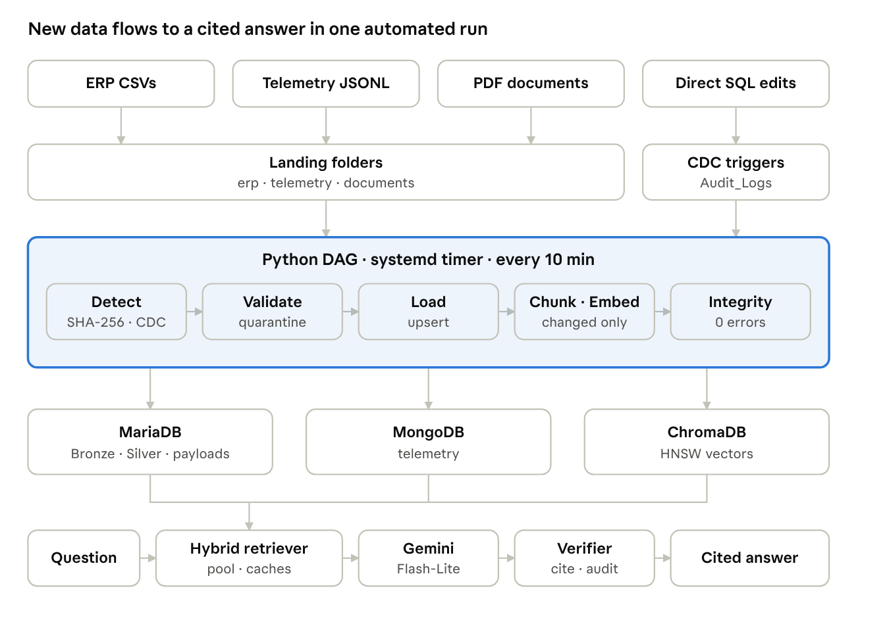

# Phase 6: automated pipeline, optimization and benchmark

This folder turns the Phase 1-5 system into one automated pipeline. New files and direct database edits are detected, cleaned, loaded into MariaDB, MongoDB and ChromaDB, and become answerable in one run, with no full reprocessing. The RAG side is optimized and benchmarked against Phase 5.



## Results

| Measure | Phase 5 | Phase 6 |
|---|---:|---:|
| Median end-to-end answer time (26 questions x 2) | 0.98 s | **0.93 s** |
| Runs under 5 s | 52/52 | **52/52** |
| Retrieval P50 / P99 | 20.4 / 79.0 ms | **6.6 / 24.1 ms** |
| Retrieval throughput, 8 clients | 24 queries/s | **162 queries/s** |
| Statements traced to a source | 213/217 | **228/228 (100%)** |
| Cited sources re-read from their database and confirmed | - | **154/154** |
| Repeated question (answer cache) | about 1 s | **0.12 ms** |

Full numbers: [`results/m6_benchmark_report.md`](results/m6_benchmark_report.md), SQL tuning, vector tuning and CDC trigger cost in the same folder.

## How it works

- **Orchestration:** a Python DAG of 12 tasks (`pipeline/run_pipeline.py`, `pipeline/orchestrator.py`) with dependencies, retries with backoff, `blocked` status after a failure, a run lock and per-task logging. A systemd timer runs it every 10 minutes.
- **New files:** polling the landing folders; a file is new when its path + SHA-256 is not in `etl_file_manifest`.
- **Direct database edits:** trigger-based CDC (`sql/11_cdc_triggers.sql`) writes every change to `Audit_Logs`; the pipeline reads the edits tagged `direct` after a saved position and ignores its own writes.
- **Incremental:** upserts for rows, a content hash per RAG payload (`rag_vector_sync`) so only changed payloads are embedded, and in-place HNSW updates (no full re-index).
- **Errors:** bad rows go to `etl_quarantine` with the reason; the merge is one transaction; an integrity check runs at the end of every run.
- **Optimized RAG:** `rag/m6_rag.py` adds a MariaDB connection pool, a primary-key claim lookup, two indexes (`sql/10_index_tuning.sql`), date windows, embedding / aggregate / answer caches keyed by a data version, re-tuned ef_search, and regenerate-then-remove for untraceable statements.

## Setup (on the Phase 5 EC2 instance)

1. **Copy the code** from the repository root on your machine:
   ```bash
   bash automation/ops/deploy.sh <key.pem> ubuntu@<public-ip>
   ```
2. **On the instance**, load the environment and run the one-time setup (pipeline tables, index tuning, CDC triggers, a first run, the timer):
   ```bash
   source /opt/gigavolt/m6/ops/env.sh
   pip install -r requirements.txt
   bash ops/setup_m6.sh
   ```
   `env.sh` activates `/opt/gigavolt_env`, loads `/opt/gigavolt/config.env` (database settings and `GEMINI_API_KEY`) and moves to `/opt/gigavolt/m6`.

## Usage

| Task | Command |
|---|---|
| Run the pipeline now | `python pipeline/run_pipeline.py --trigger manual` |
| Run history and quarantine | `python pipeline/run_pipeline.py --status` |
| Write a labelled test batch (CSV, JSONL, chosen PDFs) | `python ops/new_data_batch.py --unit EQ-7171` |
| Ask a question | `python rag/ask.py "What is the status of claim CLM-9208?"` |
| Benchmark Phase 5 vs Phase 6 | `python bench/run_benchmark.py --repeat 2` |
| SQL, vector and trigger tuning | `python bench/sql_tuning.py`, `python bench/tune_vector.py`, `python bench/trigger_overhead.py` |
| Provenance audit of recent answers | `python bench/provenance_audit.py --last 20` |
| Failure recovery test | `bash ops/recovery_test.sh` |
| Live demo of every deliverable | `python demo/m6_demo.py` |

The pipeline timer: `sudo systemctl status gigavolt-pipeline.timer` (stop or start it with `systemctl`).

## Layout

| Folder | Contents |
|---|---|
| `pipeline/` | DAG runner, orchestrator, state (manifest, quarantine, flags), ERP, CDC, telemetry and vector tasks |
| `sql/` | Pipeline tables, incremental merge (the Phase 1 cleaning SQL as upserts), index tuning, CDC triggers |
| `rag/` | Optimized RAG pipeline and the `ask.py` command line |
| `bench/` | Benchmark, 26 questions, provenance audit, SQL / vector / trigger tuning |
| `ops/` | Deploy, setup, environment, systemd units, test batches, recovery test |
| `demo/` | Screencast demo script and the sample PDFs it can drop into the landing folder |
| `results/` | Benchmark, tuning and audit reports, latency charts, raw runs |

`demo/make_demo_pdfs.py` rebuilds the sample PDFs and needs `reportlab`; nothing else does.
