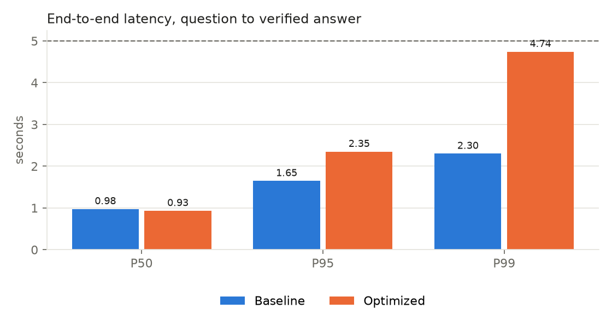
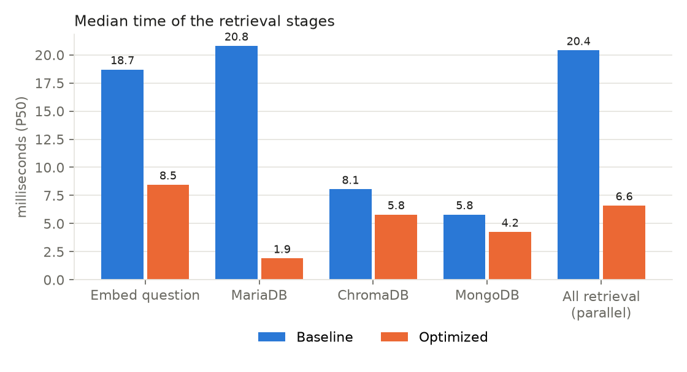

# Milestone 6 benchmark report

26 questions x 2 round(s) per pipeline, run 2026-11-15 01:45. 'baseline' is the Milestone 5 pipeline; 'optimized' is the Milestone 6 pipeline with its answer cache switched off, so these are uncached numbers. Percentiles exclude runs that hit an LLM error or a rate-limit wait (counted below).

## Summary

| Measure | baseline | optimized |
|---|---:|---:|
| Median end-to-end latency (target < 5 s) | 0.98 s | 0.93 s |
| Runs under 5 s | 52/52 | 52/52 |
| Correct answers (all expected facts present) | 48/52 (92%) | 49/52 (94%) |
| Expected sources retrieved | 52/52 (100%) | 52/52 (100%) |
| Displayed statements traced to a source | 213/217 (98.2%) | 228/228 (100.0%) |
| Answers regenerated after a verifier flag | 0 | 6 |
| Untraceable statements removed before display | 0 | 4 |
| Runs excluded from percentiles (LLM error or rate-limit wait) | 0 | 0 |

Provenance audit of the optimized answers: 154 of 154 cited sources were fetched again from their database and confirmed; every answer is fully traceable (details in m6_provenance_audit.md).

## Retrieval fidelity and accuracy by category

| Category | baseline correct | baseline sources retrieved | baseline median (s) | optimized correct | optimized sources retrieved | optimized median (s) |
|---|---:|---:|---:|---:|---:|---:|
| specification | 12/12 | 12/12 | 0.81 | 12/12 | 12/12 | 0.70 |
| temporal | 12/12 | 12/12 | 1.04 | 12/12 | 12/12 | 1.08 |
| multi-hop | 10/12 | 12/12 | 1.13 | 11/12 | 12/12 | 1.03 |
| supply chain | 10/12 | 12/12 | 1.04 | 10/12 | 12/12 | 0.94 |
| grounding | 4/4 | 4/4 | 1.06 | 4/4 | 4/4 | 1.29 |

## Latency per stage (ms)

| Stage | baseline P50 | baseline P95 | baseline P99 | optimized P50 | optimized P95 | optimized P99 |
|---|---:|---:|---:|---:|---:|---:|
| Route | 0.2 | 0.3 | 0.5 | 0.2 | 0.3 | 0.3 |
| Resolve unit | 15.5 | 15.8 | 16.0 | 0.8 | 0.8 | 0.9 |
| Embed question | 18.7 | 19.9 | 20.6 | 8.5 | 19.9 | 20.7 |
| MariaDB | 20.8 | 62.5 | 79.9 | 1.9 | 3.5 | 9.2 |
| ChromaDB | 8.1 | 23.3 | 58.0 | 5.8 | 19.4 | 23.9 |
| MongoDB | 5.8 | 7.7 | 8.1 | 4.2 | 6.6 | 7.2 |
| All retrieval (parallel) | 20.4 | 55.8 | 79.0 | 6.6 | 19.6 | 24.1 |
| Assemble context | 0.2 | 0.2 | 0.2 | 0.1 | 0.2 | 0.2 |
| LLM generation | 918.0 | 1577.8 | 2237.7 | 919.4 | 2341.6 | 4726.0 |
| Verify | 0.2 | 0.4 | 0.6 | 0.2 | 0.4 | 0.7 |
| Total | 975.2 | 1647.8 | 2301.4 | 932.0 | 2348.8 | 4743.2 |

MariaDB, ChromaDB and MongoDB run in parallel, so 'All retrieval' is close to the slowest of the three, not their sum. 'LLM generation' includes the second call when an answer was regenerated.

## Throughput

| Workload | Queries per second |
|---|---:|
| End to end with the LLM, one client, baseline | 0.94 |
| End to end with the LLM, one client, optimized | 0.86 |
| Retrieval only (no LLM), baseline, 1 concurrent client(s) | 21.3 |
| Retrieval only (no LLM), baseline, 4 concurrent client(s) | 24.2 |
| Retrieval only (no LLM), baseline, 8 concurrent client(s) | 23.7 |
| Retrieval only (no LLM), optimized, 1 concurrent client(s) | 130.4 |
| Retrieval only (no LLM), optimized, 4 concurrent client(s) | 151.4 |
| Retrieval only (no LLM), optimized, 8 concurrent client(s) | 162.2 |
| Repeated questions served from the answer cache | 7993 |

Answer cache: 130 hits, 26 misses; a cached answer takes P50 0.119 ms, P95 0.171 ms, P99 0.193 ms.

End-to-end throughput is bounded by the LLM API (one call per question, and the free tier's requests-per-minute limit), not by the databases, which is why retrieval-only throughput is reported separately.

## Per question (optimized, first round)

| ID | Category | Question | Total (s) | Correct | Sources | Traced |
|---|---|---|---:|---|---|---:|
| S1 | specification | What is the nominal capacity and nominal cell voltage of the Prismacell LFP cell? | 0.75 | yes | yes | 1/1 |
| S2 | specification | What are the current and voltage ratings of fuse FUS-FAST-600A? | 0.63 | yes | yes | 3/3 |
| S3 | specification | What is the nominal power output and energy capacity of the Megapack X-7000? | 0.69 | yes | yes | 4/4 |
| S4 | specification | What trigger current fires the ACT-PYRO-1200 pyrofuse, and how fast does it clear the arc? | 0.70 | yes | yes | 1/1 |
| S5 | specification | How far must personnel evacuate during a battery fire emergency? | 0.81 | yes | yes | 4/4 |
| S6 | specification | What does fault code ERR_BMS_708 mean and what is the corrective action? | 0.70 | yes | yes | 3/3 |
| T1 | temporal | Which warranty claims were filed for equipment unit EQ-7171 in 2021? | 0.91 | yes | yes | 3/3 |
| T2 | temporal | What happened to unit SN-X7-0094 on 2024-09-28? | 1.33 | yes | yes | 7/7 |
| T3 | temporal | Which fault codes did unit SN-X7-0150 report in September 2026? | 1.18 | yes | yes | 6/6 |
| T4 | temporal | What is the most recent warranty claim for equipment unit EQ-7171? | 0.98 | yes | yes | 9/9 |
| T5 | temporal | When did fault code ERR_COOL_302 first occur, and on which unit? | 1.32 | yes | yes | 4/4 |
| T6 | temporal | When was equipment unit EQ-7171 installed, and when does its warranty expire? | 0.68 | yes | yes | 1/1 |
| M1 | multi-hop | For the arc flash on unit SN-X7-0094, which components were flagged and what did the incident investigation report? | 1.25 | yes | yes | 6/6 |
| M2 | multi-hop | Which telemetry fault occurs most on X-7000 units, and what corrective action does the X-7000 manual give for it? | 0.81 | yes | yes | 3/3 |
| M3 | multi-hop | Show the service history of equipment unit EQ-7171 and the fault patterns seen in telemetry for its model. | 4.61 | NO | yes | 10/10 |
| M4 | multi-hop | Fault ERR_COOL_302 occurred on C-1200 units: is it covered by warranty, and what proof does the warranty SOP require? | 0.72 | yes | yes | 4/4 |
| M5 | multi-hop | Telemetry flagged part FUS-FAST-600A during ERR_FUSE_001 faults: what are that fuse's ratings? | 0.86 | yes | yes | 5/5 |
| M6 | multi-hop | What are the most common service resolutions for X-5000 units, and how many X-5000 warranty claims were approved? | 1.34 | yes | yes | 7/7 |
| C1 | supply chain | Which suppliers provide lithium cells for our commercial energy storage units? | 0.93 | yes | yes | 4/4 |
| C2 | supply chain | Which supplier makes the NMC cells used in the PowerStation G-3500? | 0.77 | yes | yes | 3/3 |
| C3 | supply chain | Which supplier is a critical sole-source risk for the inverter gate drive PCB, and what is the mitigation? | 0.88 | yes | yes | 4/4 |
| C4 | supply chain | What did the supplier quality audit of SinoPower Cell Foundry find? | 1.75 | NO | yes | 4/4 |
| C5 | supply chain | Which suppliers in our parts catalog supply lithium cell modules? | 1.09 | yes | yes | 6/6 |
| C6 | supply chain | Who is the Tier-2 cell manufacturer for the Prismacell 280Ah cell, and what secondary supplier is being qualified? | 0.93 | yes | yes | 3/3 |
| G1 | grounding | What was Gigavolt's total revenue last quarter? | 0.53 | yes | yes | 0/0 |
| G2 | grounding | Show me service history for equipment unit SN-4829 and related warranty claims | 1.30 | yes | yes | 6/6 |
